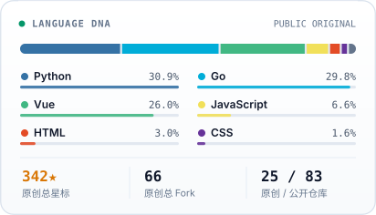
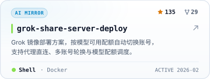
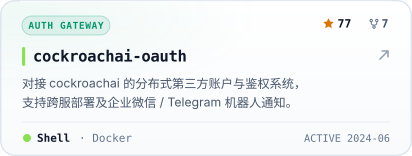
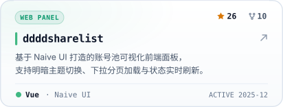
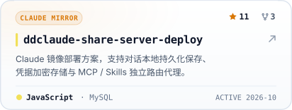
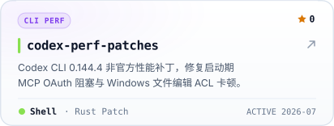
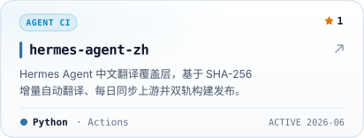
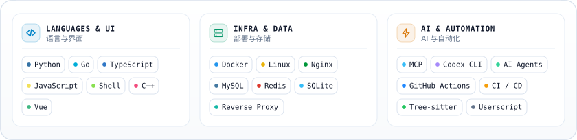

  <picture>
    <source media="(prefers-color-scheme: dark)" srcset="https://raw.githubusercontent.com/lyy0709/lyy0709/output/hero-dark.svg" />
    
  </picture>

  <a href="#telemetry">工程数据</a> &nbsp;·&nbsp;
  <a href="#projects">精选项目</a> &nbsp;·&nbsp;
  <a href="#stack">核心技术栈</a> &nbsp;·&nbsp;
  <a href="#snake">年度贡献轨迹</a>

  <picture>
    <source media="(prefers-color-scheme: dark)" srcset="./assets/section-telemetry-dark.svg" />
    
  </picture>

  <picture>
    <source media="(prefers-color-scheme: dark)" srcset="https://raw.githubusercontent.com/lyy0709/lyy0709/output/activity-dark.svg" />
    
  </picture>&nbsp;&nbsp;<picture>
    <source media="(prefers-color-scheme: dark)" srcset="https://raw.githubusercontent.com/lyy0709/lyy0709/output/languages-dark.svg" />
    
  </picture>

  <picture>
    <source media="(prefers-color-scheme: dark)" srcset="./assets/section-projects-dark.svg" />
    
  </picture>

  <a href="https://github.com/lyy0709/grok-share-server-deploy">
    <picture>
      <source media="(prefers-color-scheme: dark)" srcset="https://raw.githubusercontent.com/lyy0709/lyy0709/output/card-grok-dark.svg" />
      
    </picture>
  </a>&nbsp;&nbsp;<a href="https://github.com/lyy0709/cockroachai-oauth">
    <picture>
      <source media="(prefers-color-scheme: dark)" srcset="https://raw.githubusercontent.com/lyy0709/lyy0709/output/card-oauth-dark.svg" />
      
    </picture>
  </a>

  <a href="https://github.com/lyy0709/ddddsharelist">
    <picture>
      <source media="(prefers-color-scheme: dark)" srcset="https://raw.githubusercontent.com/lyy0709/lyy0709/output/card-sharelist-dark.svg" />
      
    </picture>
  </a>&nbsp;&nbsp;<a href="https://github.com/lyy0709/ddclaude-share-server-deploy">
    <picture>
      <source media="(prefers-color-scheme: dark)" srcset="https://raw.githubusercontent.com/lyy0709/lyy0709/output/card-claude-dark.svg" />
      
    </picture>
  </a>

  <a href="https://github.com/lyy0709/codex-perf-patches">
    <picture>
      <source media="(prefers-color-scheme: dark)" srcset="https://raw.githubusercontent.com/lyy0709/lyy0709/output/card-codex-dark.svg" />
      
    </picture>
  </a>&nbsp;&nbsp;<a href="https://github.com/lyy0709/hermes-agent-zh">
    <picture>
      <source media="(prefers-color-scheme: dark)" srcset="https://raw.githubusercontent.com/lyy0709/lyy0709/output/card-hermes-dark.svg" />
      
    </picture>
  </a>

<strong>更多开源项目与归档工具</strong>（vmq-itchat · ContextWeaver · select_course · auditlimit）

 

- **[vmq-itchat](https://github.com/lyy0709/vmq-itchat)** · `Python` · `已归档` — 对接 V 免签的微信挂机监控与 Webhook（UOS 协议，Linux 后台运行）。
- **[ContextWeaver](https://github.com/lyy0709/ContextWeaver)** · `TypeScript` · `Fork` — 基于 MCP、Tree-sitter 与向量搜索的本地代码库上下文检索工具，源自 [hsingjui/ContextWeaver](https://github.com/hsingjui/ContextWeaver)。
- **[select_course](https://github.com/lyy0709/select_course)** · `JavaScript` — 中国石油大学（北京）油猴自动选课脚本。
- **[auditlimit](https://github.com/lyy0709/auditlimit)** · `Go` · `Fork` — 内容审核与速率限制服务。

  <picture>
    <source media="(prefers-color-scheme: dark)" srcset="./assets/section-stack-dark.svg" />
    
  </picture>

  <picture>
    <source media="(prefers-color-scheme: dark)" srcset="./assets/stack-dark.svg" />
    
  </picture>

  <picture>
    <source media="(prefers-color-scheme: dark)" srcset="./assets/section-snake-dark.svg" />
    
  </picture>

  <picture>
    <source media="(prefers-color-scheme: dark)" srcset="https://raw.githubusercontent.com/lyy0709/lyy0709/output/github-snake-dark.svg" />
    
  </picture>

  <picture>
    <source media="(prefers-color-scheme: dark)" srcset="./assets/footer-dark.svg" />
    
  </picture>

